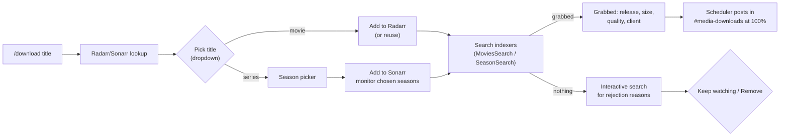

# Discord Bots

> [!NOTE] Sentinel API key — 2026-10-19
> `API_KEY` rotated from the placeholder (in `/opt/sentinel-bot/.env`; compose now refuses to start without it). The webhook/API routes do not yet enforce it — Task #99.

#homelab #discord #automation #bots #sentinel

This document describes the Discord bot infrastructure for homelab automation and notifications.

## Overview

The homelab uses a single consolidated Discord bot called **Sentinel** that replaces the previous 4 separate bots (Argus, Chronos, Mnemosyne, Athena).

| Bot | Host | Purpose |
|-----|------|---------|
| **Sentinel** | docker-vm-core-utilities01 (192.168.40.13) | Unified homelab management |
| **Roundtable backend** | codex-agent-lxc (192.168.40.16), `boss.service` | Agent polling/replies and approval workflow using the shared Sentinel Discord identity, not a second Discord member |

---

## Roundtable Agent Conversations and Approvals

that runtime, **not a separate Discord account to ping**. Its Python backend on codex-agent-lxc is
distinct from the original Sentinel Docker cogs/webhook service below.

| Route | Current behavior |
|---|---|
| `#roundtable-hold` | `@name …` talks to that agent directly (exact words, no routing); plain messages go to Gideon; ⏳→✅/⚠️ shows progress; major changes carry an RFC (Ranni). Gideon/team requests; `status`, `cost`, `approvals`, `agents`, `help`; owner ✅/❌ or `approve N` / `reject N` for the exact displayed proposal |
| Existing SRE patch approvals | Same existing executor and owner gate; patch scheduling, backup checks and rollback are unchanged |

Channel cleanup (2026-10-15): `#general`, `#container-updates`, `#claude-tasks`, `#new-service-onboarding-workflow` and `#blog-studio` were deleted after exporting their history; Sentinel's updates/onboarding now post to `#homelab-infrastructure`, its task queue and Melina's pitches to `#ideas-and-todos`.


but excluded from homelab tools/context/automatic dispatch. New corrected portraits have fresh matched
URLs; all 29 Discord icons are verified and original restoration #87 / correction #102 are closed.
The historical guild cooldown is resolved, not an outstanding upload queue.

Browser teaching **Run** is a learner action, not write authorization. Hewg's fixed learning-directory
exercise and existing bounded Torrent/Radahn changes still require owner-only Discord approval of the
exact plan, verification, rollback and documentation. Dedicated teaching voice calls cannot silently
use ordinary executors. A pending approval does not mean a command has run.

For a missing reply, first check the intended channel and the Roundtable backend independently of
Current roles, commands and release evidence ·
Teaching workflow ·
[Troubleshooting](12%20-%20Troubleshooting.md#roundtable-portal-teaching-and-discord).

---

## Sentinel - Unified Homelab Bot

**Location**: `/opt/sentinel-bot/`
**Container**: `sentinel-bot`
**Webhook Port**: 5050
**Status**: Deployed January 2026

### Architecture

```
Discord Server
     │
     ▼
Sentinel Bot (discord.py 2.3+)
├── Core
│   ├── bot.py           → Main SentinelBot class
│   ├── database.py      → Async SQLite (aiosqlite)
│   ├── channel_router.py → Notification routing
│   └── progress.py      → Progress bar utilities
│
├── Cogs (8 modules)
│   ├── homelab.py       → Proxmox cluster management
│   ├── updates.py       → Container updates + reaction approvals
│   ├── media.py         → Download monitoring + Jellyseerr
│   ├── gitlab.py        → GitLab issue management
│   ├── tasks.py         → Claude task queue
│   ├── onboarding.py    → Service verification
│   ├── scheduler.py     → Daily reports (7pm, 9am)
│   └── power.py         → Cluster power management (WoL, shutdown)
│
├── Webhooks (Quart on port 5050)
│   ├── /webhook/watchtower  → Container update notifications
│   ├── /webhook/jellyseerr  → Media request notifications
│   └── /api/tasks           → Claude task queue REST API
│
└── Services (API integrations)
    ├── proxmox.py      → Prometheus + SSH
    ├── radarr.py       → Radarr v3 API
    ├── sonarr.py       → Sonarr v3 API
    └── jellyseerr.py   → Jellyseerr API
```

### Channel Routing

| Cog | Channel | Purpose |
|-----|---------|---------|
| **Homelab** | `#homelab-infrastructure` | Proxmox status, VM/LXC/node management |
| **Updates** | `#homelab-infrastructure` (was `#container-updates`, deleted 2026-10-15) | Container updates with reaction approvals |
| **Media** | `#cinema-lounge` (was `#media-downloads`, archived 2026-10-18) | Download progress, failed download alerts, library stats |
| **GitLab** | `#roundtable-hold` (was `#project-management`, archived 2026-10-18) | Issue creation and tracking |
| **Tasks** | `#ideas-and-todos` (was `#claude-tasks`, deleted 2026-10-15) | Claude task queue management |
| **Onboarding** | `#homelab-infrastructure` (was `#new-service-onboarding-workflow`, deleted 2026-10-15) | Service verification checks |
| **Scheduler** | Various | Daily reports, download monitoring |
| **Power** | `#announcements` | Cluster power management (shutdown/startup) |

### Commands

#### Homelab (`#homelab-infrastructure`)

| Command | Description |
|---------|-------------|
| `/help` | Show all Sentinel commands in a formatted embed |
| `/insight` | Health check: memory usage, container errors, storage, failed downloads |
| `/homelab status` | Cluster overview with resource bars |
| `/homelab uptime` | Uptime for all nodes/VMs/LXCs |
| `/node <name> status` | Detailed status for a node |
| `/node <name> vms` | List VMs on a node |
| `/node <name> lxc` | List LXC containers on a node |
| `/node <name> restart` | Restart Proxmox node (with confirmation) |
| `/vm <id> status` | Get VM status |
| `/vm <id> start/stop/restart` | Control a VM |
| `/lxc <id> status` | Get LXC container status |
| `/lxc <id> start/stop/restart` | Control an LXC container |

#### Updates (`#container-updates`)

| Command | Description |
|---------|-------------|
| `/check` | Scan all containers for updates |
| `/update <container>` | Update specific container |
| `/updateall` | Update all with pending updates |
| `/updateall-except <list>` | Update all except specified |
| `/containers` | List monitored containers |

#### Media (`#cinema-lounge`)

| Command | Description |
|---------|-------------|
| `/downloads` | Current download queue with visual progress bars |
| `/download <title> [media_type]` | Find a movie or show and download it through Radarr/Sonarr (see below) |
| `/search <query>` | Search without downloading (Jellyseerr) |
| `/library movies` | Movie library statistics |
| `/library shows` | TV library statistics |
| `/recent` | Recently added media |

#### `/download` orchestration (rebuilt 2026-10-07)

Discord → Sentinel → Radarr/Sonarr → Prowlarr indexers → Deluge (SABnzbd/Usenet disabled since 2026-10-16). No LLM involved; it's deterministic code in `cogs/media.py`. Before this it was a stub: it showed a Jellyseerr result saying "react 👍", and nothing handled the reaction.



| Outcome | What Sentinel says | Buttons |
|---|---|---|
| Already has the file | "Already in your library" | none |
| Already downloading | "Already downloading" plus release info | none |
| Grabbed | Release name, size, quality, client, indexer. For TV: "Grabbed N of M missing aired episodes" | none |
| Movie not released yet (status not `released`) | Status and cinema, digital and physical dates | Keep watching / Remove |
| Nothing found | "No releases found on any indexer", or "Found N releases, none passed your rules" plus the top 3 rejection reasons | Keep watching / Remove |

- **Pick**: `/download` searches both movies and TV by default (top 5 of each). Use `media_type` to narrow it. Results already in the library are marked.
- **Seasons**: a multi-select with "All seasons" or specific seasons. Sonarr adds the series with `monitor: none`, then monitors only the chosen seasons. Specials are never auto-selected.
- **Keep watching** leaves the item monitored, so Radarr/Sonarr's RSS sync grabs it when a release appears, and the existing completion notifier posts it.
- **Remove** deletes the item if this request added it (files and import exclusions untouched). If it was already in Radarr/Sonarr, it only unmonitors it (or the chosen seasons).
- Only the person who ran the command can use its buttons. The pickers expire after 10 minutes and the Keep/Remove buttons after 24 hours. Buttons also stop working if the bot restarts; the item simply stays monitored.

**Settings** (optional `.env` overrides; defaults chosen 2026-10-07):

| Variable | Default | Notes |
|---|---|---|
| `MEDIA_QUALITY_PROFILE` | `Any` | Matched by name in both Radarr and Sonarr. Existing library items mostly use `Ultra-HD`. |
| `RADARR_ROOT_FOLDER` | `/data/Movies` | Falls back to the first root folder if missing |
| `SONARR_ROOT_FOLDER` | `/tv` | 53 of 61 series live here; `/data/Series` holds the other 8 |

Minimum availability for new movies is `released`. Searches wait up to 5 minutes; the "why not" interactive search waits up to 3.

**`/downloads` Output Format** (Updated January 2026):
```
📥 Download Queue

🎬 Movies (2)
`[████████░░]`  80.5% | Interstellar.2014.2160p.UHD
`[██░░░░░░░░]`  20.0% | The.Matrix.1999.4K

📺 TV Shows (8)
`[██████████]` 100.0% | House.of.the.Dragon.S02E05
`[█████░░░░░]`  50.0% | The.Sandman.S02E01
```

#### GitLab (`#roundtable-hold`)

| Command | Description |
|---------|-------------|
| `/todo <description>` | Create GitLab issue |
| `/issues` | List open issues |
| `/close <id>` | Close an issue |
| `/quick <tasks>` | Bulk create (semicolon-separated) |
| `/project` | Show project info |

#### Tasks (`#claude-tasks`)

| Command | Description |
|---------|-------------|
| `/task <description>` | Submit new task to queue |
| `/queue` | View pending tasks |
| `/status` | Claude instance status |
| `/done` | Completed tasks |
| `/cancel <id>` | Cancel pending task |
| `/taskstats` | Queue statistics |

#### Onboarding (`#new-service-onboarding-workflow`)

| Command | Description |
|---------|-------------|
| `/onboard <service>` | Check single service config |
| `/onboard-all` | Check all services (table) |
| `/onboard-services` | List discovered services |

#### Power (`#announcements`)

| Command | Description |
|---------|-------------|
| `/shutdownall` | Shutdown ALL VMs, LXCs, and Proxmox nodes |
| `/shutdown-nodns` | Shutdown all except Pi-hole (LXC 202) and node01 |
| `/startall` | Wake nodes via WoL, start all LXCs and VMs |

> **Confirmation Required**: All power commands require ⚠️ reaction to confirm (60-second timeout). The shutdown order is VMs → LXCs → Nodes for safety.

**Wake-on-LAN Configuration:**

| Node | MAC Address |
|------|-------------|
| node01 | `38:05:25:32:82:76` |
| node02 | `84:47:09:4d:7a:ca` |
| node03 | `d8:43:ae:a8:4c:a7` |

### Webhook Endpoints

| Endpoint | Method | Purpose |
|----------|--------|---------|
| `/health` | GET | Health check |
| `/webhook/watchtower` | POST | Container update notifications |
| `/webhook/jellyseerr` | POST | Media request notifications |
| `/api/tasks` | GET/POST | Claude task queue |
| `/api/tasks/<id>/claim` | POST | Claim task for processing |
| `/api/tasks/<id>/complete` | POST | Mark task complete |

### Update Approval Flow

Sentinel uses reaction-based approvals for container updates:

1. Watchtower detects updates → posts embed to `#container-updates`
2. User reacts with :thumbsup: to approve ALL updates
3. Number emojis (1️⃣, 2️⃣, etc.) for individual updates
4. Bot executes approved updates via SSH
5. Completion notification with status

### Database Schema

```sql
-- Claude task queue
CREATE TABLE tasks (
    id INTEGER PRIMARY KEY,
    description TEXT NOT NULL,
    status TEXT DEFAULT 'pending',
    priority TEXT DEFAULT 'medium',
    submitted_by TEXT,
    instance_id TEXT,
    instance_name TEXT,
    created_at TIMESTAMP DEFAULT CURRENT_TIMESTAMP,
    completed_at TIMESTAMP
);

-- Download progress tracking
CREATE TABLE download_tracking (
    id TEXT PRIMARY KEY,
    media_type TEXT,
    title TEXT,
    notified_milestones TEXT DEFAULT '[]',
    completed_at TIMESTAMP
);

-- Update history
CREATE TABLE update_history (
    id INTEGER PRIMARY KEY,
    container_name TEXT,
    host_ip TEXT,
    update_status TEXT,
    updated_by TEXT,
    created_at TIMESTAMP DEFAULT CURRENT_TIMESTAMP
);
```

### Scheduled Tasks

| Task | Time | Channel |
|------|------|---------|
| Update Availability Report | 7:00 PM daily | `#container-updates` |
| Onboarding Status Report | 9:00 AM daily | `#new-service-onboarding-workflow` |
| Download Completion Check | Every 60 seconds | `#cinema-lounge` |
| Failed Download Check | Every 5 minutes | `#cinema-lounge` |
| Stale Task Cleanup | Every 30 minutes | (internal) |

> **Note** (January 2026): Download notifications initially set to 100% only.

> **Updated** (February 2026): All three download notification sources fixed to completion-only:
> - **Sentinel Bot** (`scheduler.py`): `milestones = [50, 80, 100]` → `milestones = [100]` — the only actively running bot
> - **Mnemosyne Bot** (`mnemosyne-bot.py`): Removed start + progress notifications entirely, kept completion detection
> - **Download Monitor** (`download-monitor.py`): Removed start notifications (not currently deployed)
>
> Result: One Discord notification per download on completion. No start, 50%, or 80% spam.

### Failed Download Notifications

The bot checks Radarr/Sonarr queues every 5 minutes for failed downloads:
- Sends notification with error details to `#cinema-lounge`
- Includes :wastebasket: reaction to remove from queue
- One-click removal via API when user reacts

### Environment Variables

```bash
# Discord
DISCORD_TOKEN=<redacted>
DISCORD_GUILD_ID=your_guild_id

# Channels
CHANNEL_CONTAINER_UPDATES=container-updates
CHANNEL_MEDIA_DOWNLOADS=cinema-lounge
CHANNEL_ONBOARDING=new-service-onboarding-workflow
CHANNEL_ARGUS=homelab-infrastructure
CHANNEL_PROJECT_MANAGEMENT=roundtable-hold
CHANNEL_CLAUDE_TASKS=claude-tasks

# APIs
RADARR_URL=http://192.168.40.11:7878
RADARR_API_KEY=your_key
SONARR_URL=http://192.168.40.11:8989
SONARR_API_KEY=your_key
JELLYSEERR_URL=http://192.168.40.11:5056
GITLAB_URL=https://gitlab.hrmsmrflrii.xyz
GITLAB_TOKEN=your_token
GITLAB_PROJECT_ID=2
PROMETHEUS_URL=http://192.168.40.13:9090

# Webhook
WEBHOOK_PORT=5050
```

### Management

```bash
# View bot logs
ssh hermes-admin@192.168.40.13 "docker logs sentinel-bot --tail 50"

# Restart bot
ssh hermes-admin@192.168.40.13 "cd /opt/sentinel-bot && sudo docker compose restart"

# Rebuild after code changes
ssh hermes-admin@192.168.40.13 "cd /opt/sentinel-bot && sudo docker compose build --no-cache && sudo docker compose up -d"

# Check webhook health
curl http://192.168.40.13:5050/health

# View database
ssh hermes-admin@192.168.40.13 "docker exec sentinel-bot sqlite3 /app/data/sentinel.db '.tables'"
```

### Deployment

```bash
# Deploy via Ansible
cd ~/ansible
ansible-playbook sentinel-bot/deploy-sentinel-bot.yml
```

---

## File Structure

```
/opt/sentinel-bot/
├── sentinel.py              # Entry point
├── config.py                # Configuration loader
├── requirements.txt
├── Dockerfile
├── docker-compose.yml
├── .env                     # Environment variables
│
├── core/
│   ├── __init__.py
│   ├── bot.py               # SentinelBot class
│   ├── database.py          # Async SQLite wrapper
│   ├── channel_router.py    # Notification routing
│   ├── progress.py          # Progress bar utilities
│   └── ssh_manager.py       # Async SSH (asyncssh)
│
├── cogs/
│   ├── __init__.py
│   ├── homelab.py
│   ├── updates.py
│   ├── media.py
│   ├── gitlab.py
│   ├── tasks.py
│   ├── onboarding.py
│   ├── scheduler.py
│   └── power.py
│
├── webhooks/
│   ├── __init__.py
│   └── server.py            # Quart async HTTP
│
└── data/
    └── sentinel.db          # SQLite database
```

---

## Migration from Legacy Bots

Sentinel consolidates these previous bots:

| Old Bot | Replaced By | Migration Notes |
|---------|-------------|-----------------|
| Argus | `updates.py` cog | Same commands, reaction approvals added |
| Mnemosyne | `media.py` cog | Download tracking with milestone dedup |
| Chronos | `gitlab.py` cog | Same GitLab integration |
| Athena | `tasks.py` cog | Claude task queue preserved |

The old bots have been stopped and removed:
- Argus: Was on docker-vm-core-utilities01 → Now Sentinel
- Mnemosyne: Was on docker-media → **STOPPED** (use Sentinel on utils01)
- Chronos: Was on docker-vm-core-utilities01 → Now Sentinel
- Athena: Was on docker-lxc-bots → Now Sentinel

---

## Troubleshooting

### Every host shows "❌ Unreachable" (`/homelab uptime`, `/check`, node commands)
Usually **not** a network problem — check `docker logs sentinel-bot | grep sentinel.ssh`. If it says `Permission denied: '/app/.ssh/homelab_ed25519'`, the bot (runs as uid **1000** `sentinel`) can't read the mounted key. Fixed 2026-10-05: the bot uses its own copy at `/opt/sentinel-bot/ssh-key/homelab_ed25519` (owner `1000:1000`, mode 600), set via `SSH_KEY_HOST_PATH` in `.env`. Don't point it back at `/home/hermes-admin/.ssh/` (owned by uid 1001). After changing the mount, `docker compose up -d` (recreate, not restart).

### `docker compose build` fails: `open /opt/sentinel-bot/ssh-key: permission denied`
The `ssh-key/` folder (2026-10-05 fix) isn't readable by `hermes-admin`, so the build context can't include it, and every rebuild failed from 10-05 until 10-07. Fixed with `/opt/sentinel-bot/.dockerignore` (`ssh-key`, `*.bak*`, `.env.bak*`). The key is volume-mounted, so it never needs to be in the image. Watch out: on a failed build, `docker compose up -d` quietly restarts the **old** image.

### New or changed slash commands don't show up
Command sync is off by default. After changing command signatures:
```bash
cd /opt/sentinel-bot && docker compose build -q && SYNC_COMMANDS=true docker compose up -d --force-recreate
# check logs for "Commands synced to guild", then go back to normal:
docker compose up -d --force-recreate
```

### `/download` says "Not available" for everything
Check the arr side first: Sonarr/Radarr → System → Status for indexer and download-client health. On 2026-10-07 Sonarr's Deluge client was failing to authenticate (password not updated after the 09-13 Deluge reset), so TV torrents couldn't be sent anywhere.

### Bot not responding
1. Check container is running: `docker ps | grep sentinel`
2. Check logs: `docker logs sentinel-bot --tail 100`
3. Verify correct channel names in `.env`

### Commands not syncing
1. Discord slash commands take up to 1 hour to propagate
2. Restart bot to force sync
3. Check logs for "Slash commands synced" message

### Token issues
1. Regenerate token in Discord Developer Portal
2. Update `.env` with new token
3. Recreate container: `docker compose down && docker compose up -d`

### Download notifications repeating
**Fixed January 2026**: The scheduler now uses in-memory cache and only notifies on 100% completion.

If issues persist:
1. Restart the bot to clear the in-memory cache:
   ```bash
   cd /opt/sentinel-bot && sudo docker compose restart
   ```
2. The `_download_cache` is cleared when bot restarts, preventing duplicate notifications.

### Webhook not receiving updates
1. Verify Watchtower has correct URL: `http://192.168.40.13:5050/webhook/watchtower`
2. Test webhook: `curl http://192.168.40.13:5050/health`
3. Check firewall allows port 5050

---

## Related Documents

- [Deployed Services](07%20-%20Deployed%20Services.md)
- [Watchtower Updates](19%20-%20Watchtower%20Updates.md)
- [GitLab CI/CD](20%20-%20GitLab%20CI-CD%20Automation.md)
- [Arr Media Stack](08%20-%20Arr%20Media%20Stack.md)
- [Service Onboarding](22%20-%20Service%20Onboarding%20Workflow.md)

---

*Created: December 26, 2025*
*Updated: October 7, 2026 (`/download` orchestration, .dockerignore build fix)*
*Bot: Sentinel (consolidated)*
